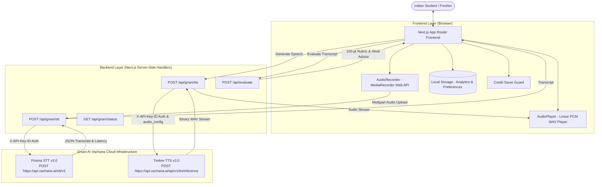

# AwaazPath (आवाज़ पथ) 🎙️🇮🇳
> **"Your Voice. Your Confidence. Your Career."**  
> *A Voice-First AI Career Coach for Indian Students.*  
> **Challenge Submission:** Great Indian AI Internship Challenge by Gnani AI.

---

## 🌟 Executive Summary & Problem Statement

In India, hundreds of thousands of talented engineering and college graduates from **Tier 2 and Tier 3 cities** (such as Jabalpur, Indore, Lucknow, Patna, Nagpur, Coimbatore, Warangal) possess exceptional mathematical and software engineering fundamentals. However, they routinely encounter barrier hurdles during campus placement drives and technical interviews.

### The Real Problem:
1. **Thinking in the Mother Tongue:** Students naturally think in Hindi or regional languages and express themselves in conversational **Hinglish**.
2. **Evaluation Bias of Traditional AI Tools:** Western speech platforms penalize Indian accents, fail to recognize code-mixed Hinglish, and misinterpret normal hesitation as incompetence.
3. **Anxiety & Lack of Structured Practice:** Many students have never experienced a mock technical or HR interview before facing actual placement panels.
4. **Vocabulary & Articulation Gap:** Candidates often struggle to translate everyday vernacular thoughts into professional corporate English (e.g., converting *"Maine project time par khatam kar diya tha"* into *"I spearheaded this module and delivered within the sprint milestone"*).

**AwaazPath** bridges this divide by harnessing **Gnani AI's state-of-the-art Indian language speech models (Prisma STT and Timbre TTS)**. It empowers students to speak freely using their microphone in Hindi, English, or Hinglish, transcribes their speech with precision, evaluates responses against a transparent 100-point rubric, and speaks back polished answers with authentic Indian voice models.

---

## 🚀 Key Features

| Feature | Description |
| :--- | :--- |
| **🎙️ Voice-First Mock Interviews** | Practice HR, Technical, Behavioral, Communication, Internship, and Placement interviews using your live microphone. |
| **🇮🇳 Multilingual Code-Mixed Speech** | Speak in pure Hindi (`hi-IN`), Indian English (`en-IN`), or conversational Hinglish with automatic language detection (`indic-auto`). |
| **⚡ Gnani Prisma STT Integration** | Live integration with `prisma-v3.0` via `POST https://api.vachana.ai/stt/v3` with `codemix` and `transliterate` formatting. |
| **🔊 Gnani Timbre TTS Coaching** | Spoken pronunciation coaching via `POST https://api.vachana.ai/api/v1/tts/inference` streaming linear PCM WAV audio with Indian voices (`Nalini`, `Rohan`). |
| **📊 Transparent 100-Point Evaluation** | Objective scoring across Relevance (25), Clarity (20), Communication (20), Structure (20), and Confidence indicators (15). |
| **✨ Answer Improvement Studio** | Generates 3 versions of every answer: Original, Professional STAR format (MNC-ready), and Simple Natural Fresher. |
| **🤖 Multilingual Voice Career Coach** | Explains tough corporate jargon (e.g., *bandwidth*, *idempotent*, *scalability*) in Hindi and structures answers. |
| **🛡️ Credit Saver Architecture** | Built-in safeguards specifically preserving your **5,000 Gnani programme credits** (no auto-polling, explicit user confirmation, audio preview). |
| **📈 Local Progress Analytics** | Tracks readiness score, verbal improvements, strongest & weakest categories, and session history in `localStorage`. |
| **🎮 Zero-Credit Demo Mode** | Complete interactive sample workflows allow testing and evaluation without microphone permissions or spending API credits. |

---

## 🏗️ Architecture & Technology Stack



### Tech Stack Details:
- **Framework:** Next.js 15 (App Router, React 19)
- **Language:** TypeScript 5.7 (Strict type safety, zero `any`)
- **Styling:** Tailwind CSS (Modern AI dark navy & electric violet aesthetic)
- **Icons:** Lucide React
- **Audio Processing:** Browser MediaRecorder API (24kHz mono PCM/WebM/WAV)
- **Speech Stack:** Gnani AI Prisma STT (`prisma-v3.0`) & Timbre TTS (`timbre-v3.0`)
- **Testing:** Node.js native test runner (`node --test`), ESLint, TypeScript compiler
- **Storage:** LocalStorage (Lightweight, local-first, zero cloud database overhead)

---

## 🔒 Gnani AI Integration Architecture

### 1. Speech-to-Text (STT): Gnani Prisma v3.0
- **Endpoint:** `POST https://api.vachana.ai/stt/v3`
- **Authentication:** `X-API-Key-ID: <GNANI_API_KEY>` (Kept strictly server-side)
- **Payload:** `multipart/form-data`
  - `audio_file`: binary audio recording (up to 30s)
  - `model`: `prisma-v3.0`
  - `language_code`: `indic-auto` (or `hi-IN`, `en-IN`)
  - `format`: `codemix` (enables seamless Hinglish Latin-script output)
- **Official JSON Response:**
  ```json
  {
    "success": true,
    "request_id": "5c1f0a52-6d62-4e0b-9a38-2f2b8a8f7a10",
    "transcript": "Sir humara final year project KisanDirect tha...",
    "model": "prisma-v3.0",
    "detected_language_code": "hi-IN",
    "processing_time": 0.58,
    "end_to_end_latency": 0.66
  }
  ```

### 2. Text-to-Speech (TTS): Gnani Timbre v3.0
- **Endpoint:** `POST https://api.vachana.ai/api/v1/tts/inference`
- **Authentication:** `X-API-Key-ID: <GNANI_API_KEY>`
- **Content-Type:** `application/json`
- **Payload:**
  ```json
  {
    "text": "For our capstone project, our team built KisanDirect...",
    "voice": "Nalini",
    "model": "timbre-v3.0",
    "language": "hi-IN",
    "speed": 1.0,
    "audio_config": {
      "encoding": "linear_pcm",
      "container": "wav",
      "num_channels": 1,
      "sample_rate": 24000,
      "sample_width": 2
    }
  }
  ```
- **Response:** Raw binary `audio/wav` stream played directly in the custom audio player.

---

## 🛡️ Credit Conservation Strategy (5,000 Credit Limit)

To strictly conserve the user's **5,000 programme credits from Gnani AI**, AwaazPath enforces the following engineering rules:
1. **No Auto-Triggering:** Zero voice API calls occur on page mount, background navigation, or build time.
2. **Explicit User Action:** Both STT and TTS require a direct, deliberate button click.
3. **Audio Preview:** Users can preview and re-record their audio locally before sending a single byte to the backend.
4. **Editable Transcripts:** Users can fix minor typos manually rather than re-running speech-to-text.
5. **Zero-Credit Demo Mode:** Pre-loaded with genuine Hinglish recordings and sample responses so judges can evaluate all 6 categories without spending a single API credit.
6. **Usage Dashboard:** The `/settings` page monitors application STT/TTS calls and latency, clearly distinguishing local request counts from platform credit balances.

---

## 📋 Evaluation Scoring Rubric (100 Points Total)

Every candidate response is evaluated using a deterministic, transparent scoring engine:
- **Relevance (25 pts):** Keyword alignment, context coverage, addressing core question themes.
- **Clarity (20 pts):** Pacing, brevity, and absence of conversational filler words (*basically, actually, matlab, like*).
- **Communication (20 pts):** Vocabulary diversity, professional sentence connectors, and transition smoothness.
- **Structure (20 pts):** Application of the STAR method (Situation, Task, Action, Result).
- **Confidence Indicators (15 pts):** Transcript-based ownership verbs (*"I spearheaded", "I delivered"*) versus hesitant phrases (*"maybe", "I guess"*). *Note: No pseudo-voice emotion detection is claimed.*

---

## ⚙️ Quickstart & Local Setup

### 1. Prerequisites
- Node.js `v18.18+` or `v20+` or `v22+` (Tested on Node `v22.17.0`)
- npm `v9+` or `v10+`

### 2. Installation
```bash
git clone https://github.com/your-username/AwaazPath.git
cd AwaazPath
npm install
```

### 3. Environment Configuration
Create a `.env` file in the root directory (refer to `.env.example`):
```bash
# Gnani AI API Key (Obtain from https://app.gnani.ai)
GNANI_API_KEY=your_gnani_api_key_here

# Speech Models
GNANI_STT_MODEL=prisma-v3.0
GNANI_TTS_MODEL=timbre-v3.0
```

> **Note:** If you don't have a Gnani API key yet, the application starts immediately in **Demo Sandbox Mode**, where all modules, 60+ questions, evaluations, and sample Hinglish voice workflows operate flawlessly.

### 4. Running the Development Server
```bash
npm run dev
```
Open [http://localhost:3000](http://localhost:3000) in your web browser.

### 5. Running Automated Tests
```bash
npm test
```
Runs the 11 unit tests covering rubric integrity, Gnani payload construction, boundary conditions, and mock API handling.

### 6. Production Build
```bash
npm run build
npm run start
```

---

## 📂 Project Directory Structure

```
d:/AwaazPath/
├── .env.example              # Environment variables template
├── package.json              # Dependencies and test scripts
├── tsconfig.json             # Strict TypeScript compiler options
├── tailwind.config.ts        # Custom dark navy theme configuration
├── docs/                     # Comprehensive architecture documentation
│   ├── ARCHITECTURE.md       # Technical design and data flows
│   ├── GNANI_INTEGRATION.md  # Official Prisma and Timbre specifications
│   ├── DEMO_SCRIPT.md        # 60-Second LinkedIn demo presentation script
│   └── DEPLOYMENT.md         # Production deployment instructions
├── src/
│   ├── app/
│   │   ├── layout.tsx        # Global HTML layout and navbar
│   │   ├── page.tsx          # Premium SaaS Landing Page
│   │   ├── globals.css       # Tailwind directives & glow effects
│   │   ├── dashboard/page.tsx# Readiness analytics & practice activities
│   │   ├── interview/page.tsx# AI Mock Interview with live mic & Prisma
│   │   ├── assistant/page.tsx# Multilingual Voice Assistant & vocabulary
│   │   ├── studio/page.tsx   # Answer Improvement Studio (3 versions)
│   │   ├── progress/page.tsx # Analytics & past sessions inspection
│   │   ├── settings/page.tsx # API status & Credit Saver configuration
│   │   └── api/
│   │       ├── gnani/stt/    # Secure server-side Prisma STT proxy
│   │       ├── gnani/tts/    # Secure server-side Timbre TTS proxy
│   │       ├── gnani/status/ # API health & model verification
│   │       └── evaluate/     # 100-Point rubric evaluation route
│   ├── components/
│   │   ├── layout/           # Navbar, Footer
│   │   └── ui/               # AudioRecorder, AudioPlayer, ScoreCard, TranscriptEditor
│   ├── lib/
│   │   ├── constants.ts      # Categories, voices, languages, rubrics
│   │   ├── gnani.ts          # Authentic Gnani Vachana REST client
│   │   ├── questions.ts      # 60+ Indian campus placement questions
│   │   ├── evaluation.ts     # Transparent 100-point rubric engine
│   │   ├── assistant-engine.ts# Hinglish converter & Hindi dictionary
│   │   ├── sample-data.ts    # Rich demo samples & past sessions
│   │   └── storage.ts        # Safe LocalStorage persistence
│   └── types/
│       └── index.ts          # Core TypeScript data contracts
└── test/
    ├── evaluation-engine.test.js # Rubric validation tests
    └── gnani-client.test.js      # Mock Gnani API and payload tests
```

---

## 🇮🇳 Impact on Bharat & Tier 2/3 Students

AwaazPath isn't just another mock interview tool; it is an **empowerment engine** designed for the linguistic and socio-economic realities of Indian youth:
- **Respects the Mother Tongue:** Recognizes that thinking in Hindi is a cognitive asset, not a deficiency.
- **Accurate Vernacular Recognition:** Powered by Gnani Prisma v3.0, it doesn't stumble on Indian colloquialisms or code-switching.
- **Dismantles Placement Anxiety:** By practicing in a low-stakes, non-judgmental environment, regional students gain the verbal fluency needed to clear Fortune 500 interviews and startup hiring challenges.

---

## 📜 Challenge Attribution & Hashtags

Developed for the **Great Indian AI Internship Challenge by Gnani AI**.

#GnaniAI #GreatIndianAIInternshipChallenge

