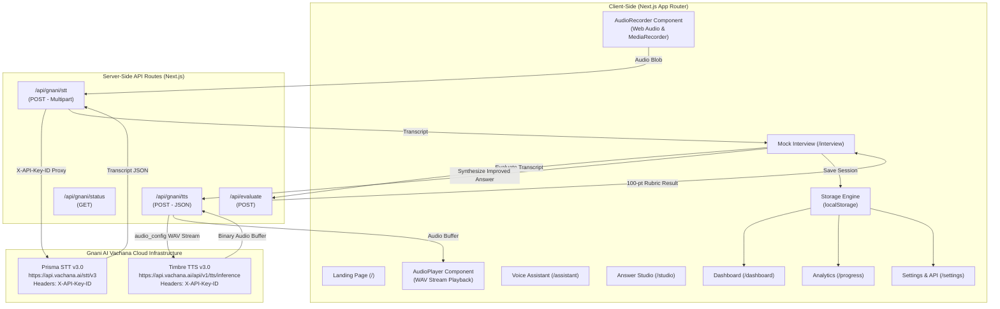

# AwaazPath Architecture & Design Document

## 1. Architectural Philosophy

AwaazPath is engineered around three primary principles:
1. **Linguistic Equity:** Built specifically for Indian freshers and Tier 2/3 students who naturally think in Hindi and speak code-mixed Hinglish.
2. **Resource & Credit Consciousness:** Safeguarding the candidate's limited 5,000 Gnani AI credits through explicit triggers, audio previewing, and zero background polling.
3. **Local-First & Privacy Conscious:** Avoiding persistent storage of raw user voice recordings on remote servers. All user analytics, session histories, and preferences live securely in the browser's `localStorage`.

---

## 2. System Architecture



---

## 3. Data Models & State Flow

### A. Interview Session
```typescript
export interface InterviewSession {
  id: string;
  timestamp: number;
  category: 'hr' | 'technical' | 'behavioral' | 'communication' | 'internship' | 'fresher';
  questionId: string;
  questionText: string;
  transcript: string;
  detectedLanguage?: string;
  evaluation: EvaluationResult;
  isDemo?: boolean;
}
```

### B. Evaluation Result & 100-Point Rubric
```typescript
export interface RubricScores {
  relevance: number;     // 25 points max
  clarity: number;       // 20 points max
  communication: number; // 20 points max
  structure: number;     // 20 points max (STAR framework)
  confidence: number;    // 15 points max (transcript ownership indicators)
  total: number;         // 100 points max
}
```

---

## 4. Security & Privacy Safeguards

1. **Server-Side API Key Shielding:** The Gnani API key is never bundled in frontend JavaScript, window variables, or network payloads visible in developer tools. All calls route through Next.js server handlers.
2. **Audio Ephemerality:** Audio recordings captured by `MediaRecorder` are retained in browser RAM only long enough to transcribe or preview. Raw audio is never permanently saved to disks or external buckets.
3. **Input Validation:**
   - Audio file size capped at 15MB.
   - Recording duration capped at 30 seconds (conforming to Prisma REST requirements).
   - Text synthesis payloads capped at 2,000 characters.
   - 25-second server timeout on upstream Gnani endpoints to prevent hanging sockets.
